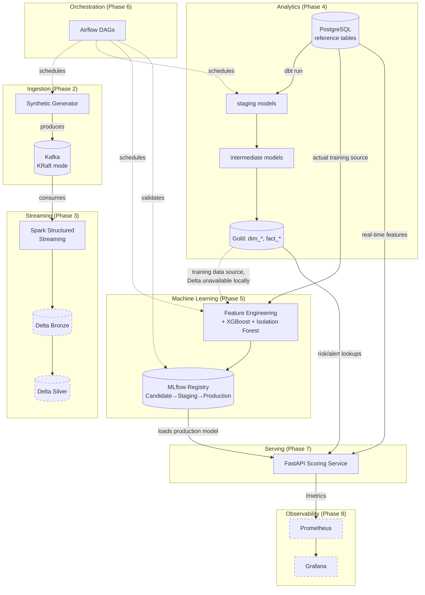
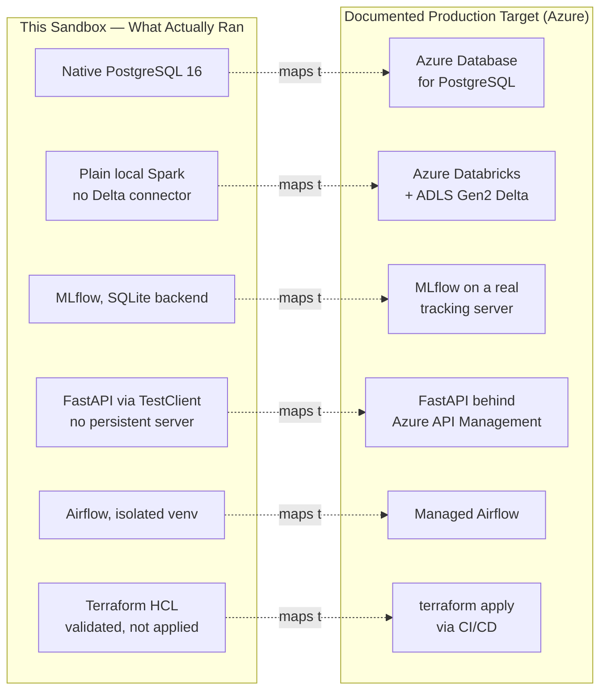
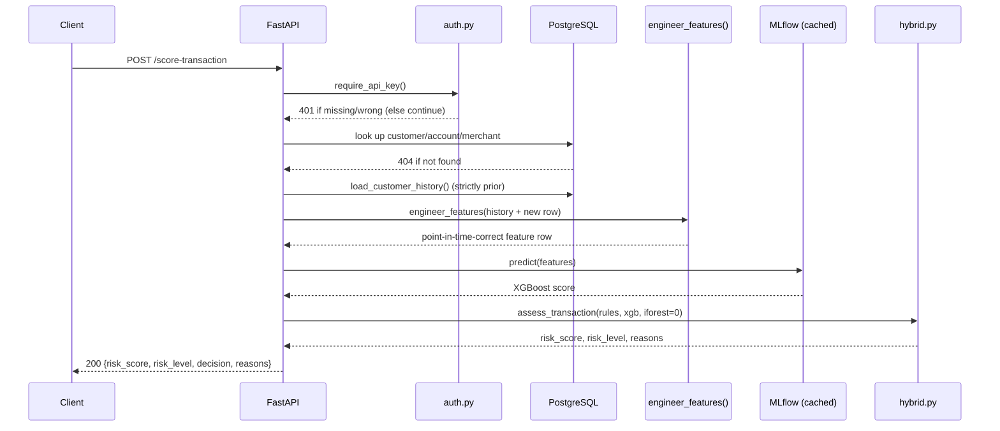
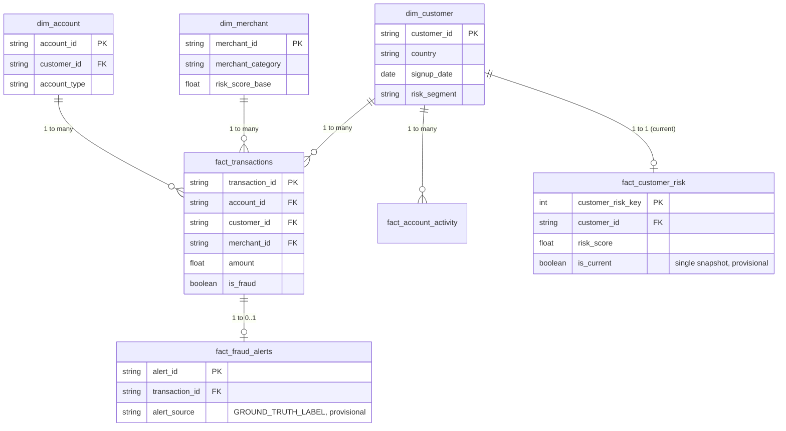

# FinGuard Financial — Architecture Diagrams

Mermaid diagrams render natively in GitHub's markdown viewer. Each
diagram reflects what was actually built across Phases 0–10, with
execution status noted where relevant — consistent with this project's
"no fake results" principle applied to diagrams too: a box on a diagram
here corresponds to real code, not aspiration.

## 1. End-to-End System Architecture


*Dashed-border nodes (Delta Bronze/Silver, Prometheus, Grafana) are
implemented and unit/HCL-tested but never executed end-to-end in this
sandbox — see each phase's own docs for the specific blocker (Maven
Central for Delta, Docker for Prometheus/Grafana).*

## 2. Local vs. Production Deployment



## 3. Fraud Scoring Request Flow



## 4. Gold Layer Star Schema



## 5. What "NOT RUN" Actually Means Across Phases

```mermaid
flowchart LR
    A[Phase 2: Kafka] -->|Docker daemon unavailable| X1[NOT RUN]
    B[Phase 3: Delta Lake] -->|Maven Central blocked| X2[NOT RUN]
    C[Phase 8: Prometheus/Grafana] -->|Docker daemon unavailable| X3[NOT RUN]
    D[Phase 10: terraform apply] -->|Registry blocked| X4[NOT RUN]

    X1 -.-> Y1[Code + unit tests: VERIFIED]
    X2 -.-> Y2[Transformations + watermarking: VERIFIED with real Spark]
    X3 -.-> Y3[/metrics endpoint: VERIFIED, 8/8 tests]
    X4 -.-> Y4[HCL syntax + composition: VERIFIED, 2 independent tools]
```
*Every "NOT RUN" in this project is paired with what WAS independently
verified in its place — never a bare, unqualified gap.*
